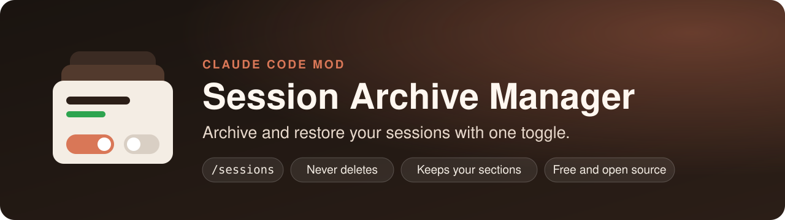
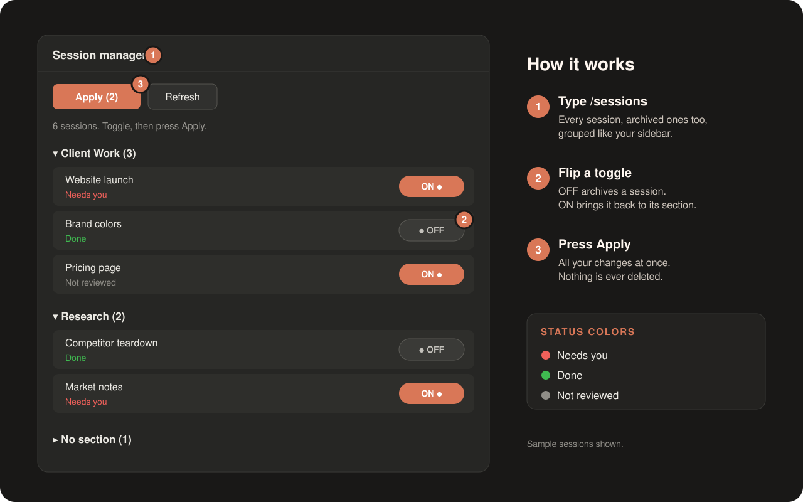

<div align="center">



# 🗂️ Session Archive Manager

**Archive and restore your Claude Code sessions with one toggle. Nothing is ever deleted.**

[](https://github.com/SaudGan/session-archive-manager-mod/releases/latest)
[](LICENSE)
[](https://github.com/SaudGan/session-archive-manager-mod/stargazers)
[](#-install)
[](tests/session-manager.test.tsx)
[](CONTRIBUTING.md)

**[Install](#-install) · [Features](#-features) · [How to use it](#-how-to-use-it) · [FAQ](#-faq) · [Contributing](#-contributing)**

</div>

---

<p align="center">
  
</p>

Run Claude Code for a few weeks and your sidebar fills up. Finished tasks sit next to live ones, and once you archive a session there is no list to find it again.

Type **`/sessions`** and get one calm pane with every session you have, archived ones included, grouped exactly like your sidebar. Flip a toggle, press **Apply**, done.

## 🔁 Before and after

| 😩 Without it | 😌 With Session Archive Manager |
|---|---|
| Archived sessions disappear from view | 📋 Every session in one list, archived ones too |
| You archive sessions one at a time | 🔘 Flip several toggles, press **Apply** once |
| A restored session lands outside its section | 📁 It goes back into its original section |
| You can't tell what is finished | 🚦 Each session shows **Needs you**, **Done** or **Not reviewed** |
| One wrong click and a session is gone | 🛡️ It only archives and restores, it never deletes |

## 🚀 Install

You need the **Claude desktop app** with its **Code** tab. The mod uses the app's own session list.

**From a terminal** (macOS Terminal, or any shell):

```bash
claude plugin marketplace add SaudGan/session-archive-manager-mod
claude plugin install session-manager@session-archive-manager-mod
```

Then open a new session in the Code tab and type **`/sessions`**. 🎉

<details>
<summary><strong>Prefer the prompt box of a Claude Code session?</strong></summary>

```
/plugin marketplace add SaudGan/session-archive-manager-mod
/plugin install session-manager@session-archive-manager-mod
```

</details>

<details>
<summary><strong>🔐 Let Apply work in auto mode</strong></summary>

In auto mode, Claude Code's safety check refuses actions you didn't ask for in the chat, and a button press doesn't count. To let **Apply** work, add these three rules to `permissions.allow` in `~/.claude/settings.json`:

```json
"mcp__ccd_session_mgmt__archive_session",
"mcp__ccd_session_mgmt__unarchive_session",
"mcp__ccd_sidebar__move_sessions"
```

They allow archiving, restoring and moving sessions into sidebar sections. They never allow deleting. Without them, use a mode that asks first and click **Allow** on each change.

</details>

## ✨ Features

- 📋 **One list for every session.** Active and archived, in the same sections you already use.
- 📂 **Folding sections.** Open a section to see what's inside, close it to keep things tidy. Each heading shows how many sessions it holds.
- 🔘 **A toggle on every row.** **ON** means the session shows in your sidebar. **OFF** means it's archived.
- ✅ **One Apply for everything.** Flip as many toggles as you like. **Apply (n)** tells you how many changes are waiting.
- 📁 **Sections are remembered.** An archived session stays under its heading, and a restored one goes back into it.
- 🚦 **Color-coded status.** 🔴 **Needs you**, 🟢 **Done** and ⚪ **Not reviewed** show where to look first.
- 🤖 **Claude fills in the statuses.** The mod gives Claude a `set_session_status` tool, so it can review your sessions for you.
- 🕒 **Newest first.** Inside every section, your most recent sessions come first.
- 💬 **Clear messages.** If a change doesn't go through, the pane names the session and the reason.

## 🧭 How to use it

1. **Work as usual.** Start as many sessions as you like.
2. **Ask Claude for a review.** For example: *"Review my sessions and mark each one as done or needs me."*
3. **Type `/sessions`.** Your sections appear, with colors showing where to look first.
4. **Clean up in seconds.** Turn **OFF** everything that's finished, then press **Apply**.
5. **Need one back?** Turn it **ON** and press **Apply**. It returns to its original section.

## 🛡️ Safe by design

- 🚫 It never deletes a session. It only archives, restores and moves sessions into sidebar sections.
- 💻 It reads your session list on your own computer. Nothing is sent anywhere else.
- 🔓 It is free and open source under the MIT license, so you can read every line.

## ❓ FAQ

<details>
<summary><strong>Where do my archived sessions go?</strong></summary>

They stay in the Claude desktop app, hidden from the sidebar. Type `/sessions` to see them under their original section, and turn one **ON** to bring it back.

</details>

<details>
<summary><strong>Apply says a change "did not go through". What now?</strong></summary>

The pane names the session and the reason. A session that is still working can't be archived, so wait for it to finish. In auto mode, add the three allow rules from the install section.

</details>

<details>
<summary><strong>Does it work in a plain terminal session?</strong></summary>

No. The list comes from the Claude desktop app, so a plain terminal session has no sessions to show.

</details>

<details>
<summary><strong>How do I update or remove it?</strong></summary>

```bash
claude plugin marketplace update session-archive-manager-mod
claude plugin update session-manager@session-archive-manager-mod
```

To remove it:

```bash
claude plugin uninstall session-manager@session-archive-manager-mod
```

</details>

## 🗺️ Ideas for next versions

- 🔎 A search box to find a session by name
- 🧹 "Archive all Done" in one click
- 🏷️ Filter the list by status

Want one of these, or something else? [Open an issue](https://github.com/SaudGan/session-archive-manager-mod/issues/new/choose) and say so.

## 🤝 Contributing

Bug reports, ideas and pull requests are all welcome. [CONTRIBUTING.md](CONTRIBUTING.md) shows how to run the mod and its tests on your own computer.

If the mod saves you time, a ⭐ on this repository helps other people find it.

## 📄 License

[MIT](LICENSE) © SaudGandeh
